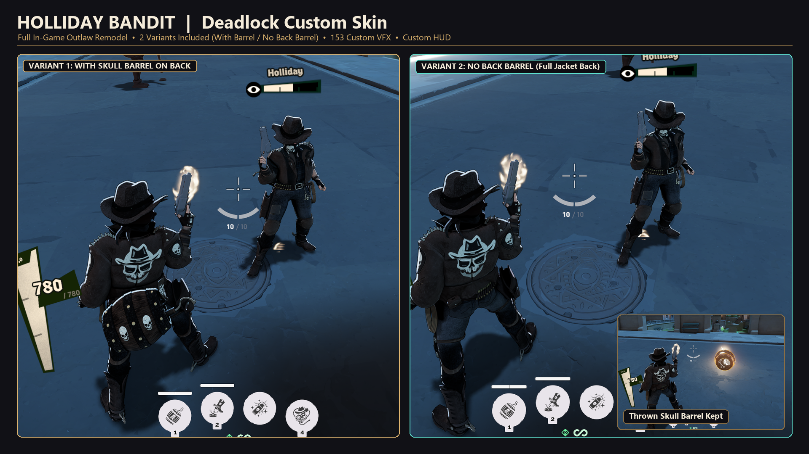
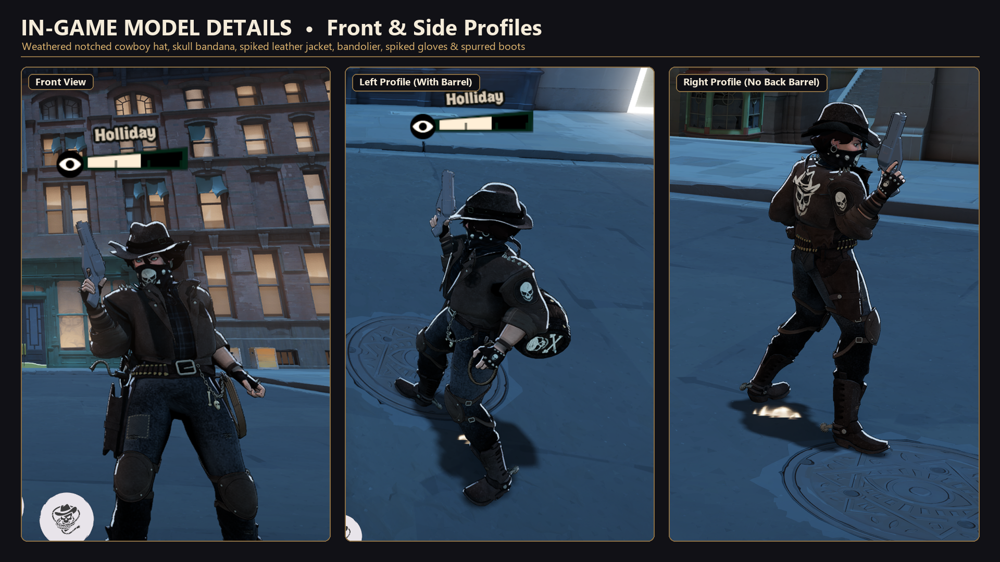
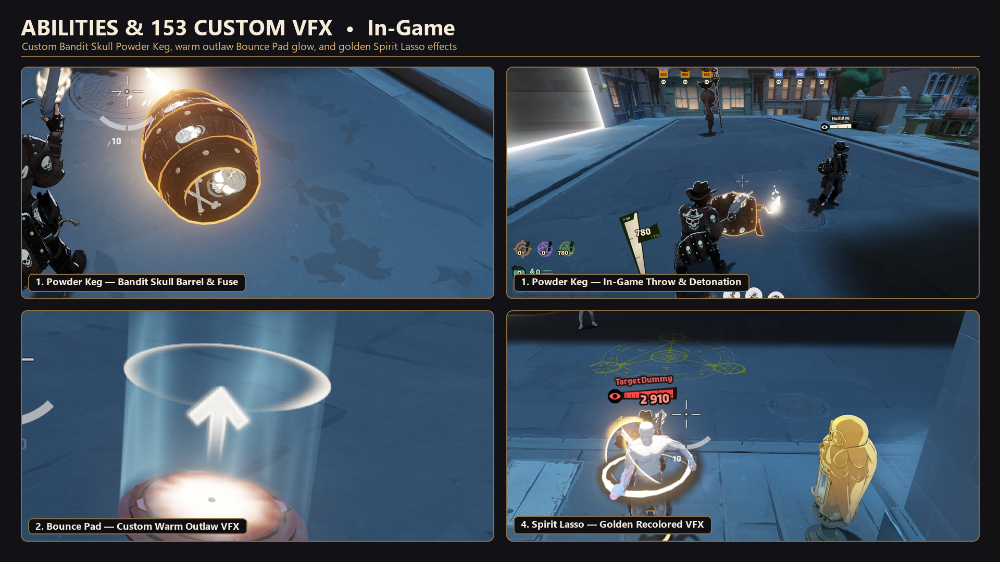
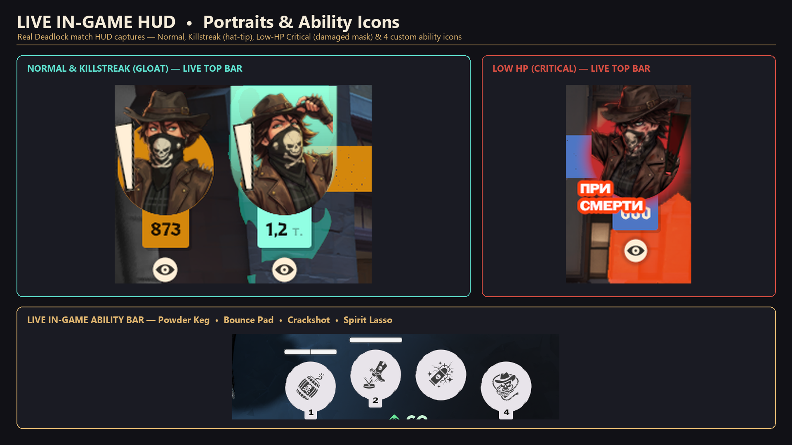

[Русский](README.ru.md)

# Holliday Bandit for Deadlock — v1.0

Outlaw bandit remodel for Holliday (`astro`). Replaces her outfit with a dark cowboy hat, skull bandana mask, studded leather jacket with cowboy-skull back and sleeve patches, bandolier belt, chains, knee pads, spurs, and a skull Powder Keg. Includes 153 recolored ability and weapon particle effects, custom HUD portraits (normal, low HP, killstreak), minimap icons, and 4 custom ability icons.

- [Download v1.0 (GitHub Releases)](https://github.com/hqvdvn-cmd/holliday-bandit-deadlock/releases/tag/v1.0)
- [GameBanana (1-Click Install & downloads)](https://gamebanana.com/mods/745535)
- [YouTube showcase (1080p60)](https://youtu.be/fDxjrjtdX7M)

## Variants (install one at a time)

- **`holliday-bandit-v1.0-with-barrel.zip`** — keeps the custom skull Powder Keg strapped to Holliday's back; the thrown Powder Keg also uses the skull keg model.
- **`holliday-bandit-v1.0-no-barrel.zip`** — removes the barrel from her back so the full cowboy-skull jacket patch stays visible; the thrown Powder Keg still uses the skull keg model.

Both archives pack `pak90_dir.vpk` (187 entries: 21 model/material/texture assets, 13 UI textures, 153 VFX particles). Checksums are listed in [SHA256SUMS.txt](SHA256SUMS.txt) and [manifest.json](manifest.json).

## Install with a mod manager

1. Close Deadlock.
2. Disable any previous Holliday skin or Holliday VFX/UI mod.
3. Import **one** of the two ZIP archives in Deadlock Mod Manager, Grimoire, or HELLCAT (or use 1-Click Install on GameBanana) and enable it.

## Manual installation

1. Close Deadlock and back up `game/citadel/gameinfo.gi`.
2. In Steam, open Deadlock → Properties → Installed Files → Browse, then go to `game/citadel`.
3. Extract `pak90_dir.vpk` from your chosen ZIP into `game/citadel/addons/`. If `pak90_dir.vpk` is already used by another mod, rename it to another unused `pakNN_dir.vpk` slot (for example `pak91_dir.vpk`).
4. In `game/citadel/gameinfo.gi` → `FileSystem` → `SearchPaths`, make sure `Game citadel/addons` appears above `Game citadel`. Keep existing `Mod`/`Write` and language entries intact.

To uninstall, remove the copied `pak90_dir.vpk` (or disable the mod in your manager).

## In-game preview

## Compatibility and notes

- Both variants were tested in-game in Deadlock (model angles, thrown Powder Keg, Bounce Pad, Crackshot, Spirit Lasso, HUD portraits, and ability icons).
- Use only one Holliday Bandit variant at a time.
- Conflicts with other mods that replace Holliday's hero model, ability/HUD icons, or `astro` particle effects.
- Major Deadlock updates that alter Holliday's skeleton, shaders, or UI paths may require a mod rebuild. For bug reports, include a screenshot or short clip, game build, and active mods.

Deadlock hero base, rig, and animations: Valve. [Full credits](CREDITS.md).
