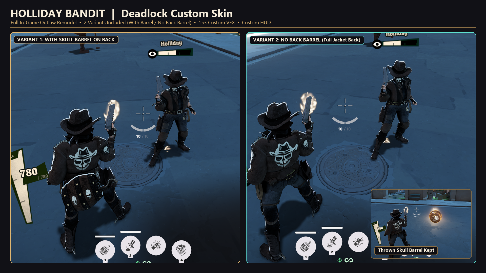
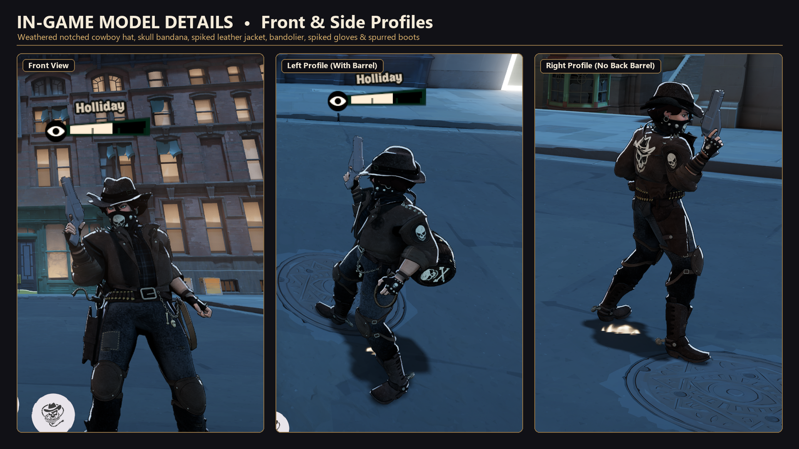
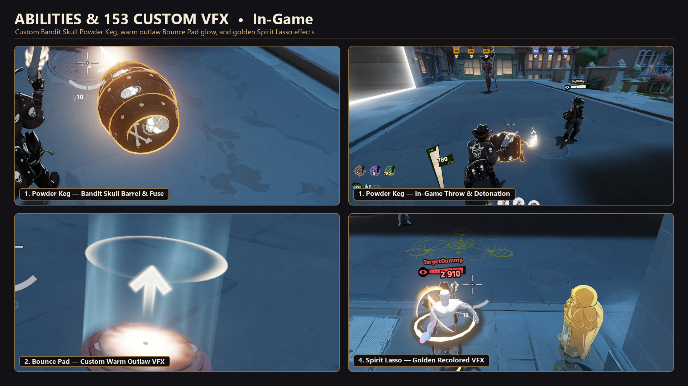
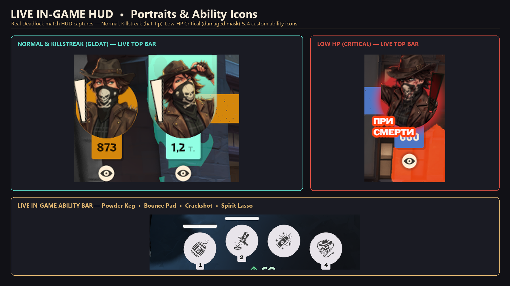

[English](README.md)

# Holliday Bandit для Deadlock — v1.0

Скин-ремодель в бандитском стиле для Holliday (`astro`). Тёмная ковбойская шляпа, маска-бандана с черепом, кожаная куртка с шипами и нашивками, патронташ, цепи, наколенники, шпоры и пороховая бочка с черепами. В комплекте 153 перекрашенных партикл-эффекта атак и способностей, кастомные портреты HUD (обычный, low HP, серия убийств), иконки миникарты и 4 иконки способностей.

- [Скачать v1.0 (GitHub Releases)](https://github.com/hqvdvn-cmd/holliday-bandit-deadlock/releases/tag/v1.0)
- [GameBanana (1-Click Install и файлы)](https://gamebanana.com/mods/745535)
- [Обзор на YouTube (1080p60)](https://youtu.be/fDxjrjtdX7M)

## Варианты (ставить по одному)

- **`holliday-bandit-v1.0-with-barrel.zip`** — пороховая бочка с черепами закреплена на спине; брошенная бочка также использует модель с черепами.
- **`holliday-bandit-v1.0-no-barrel.zip`** — бочка со спины убрана, открыт принт на спине куртки; при броске Powder Keg модель бочки с черепами сохраняется.

Внутри каждого архива лежит `pak90_dir.vpk` (187 ресурсов: 21 модель/материал/текстура, 13 UI-текстур, 153 VFX-партикла). Контрольные суммы приведены в [SHA256SUMS.txt](SHA256SUMS.txt) и [manifest.json](manifest.json).

## Установка через менеджер модов

1. Закрой Deadlock.
2. Отключи предыдущие скины и моды на HUD/эффекты для Holliday.
3. Импортируй **один** из двух ZIP-архивов в Deadlock Mod Manager, Grimoire или HELLCAT (либо установи через 1-Click Install на GameBanana) и включи мод.

## Ручная установка

1. Закрой Deadlock и сделай резервную копию `game/citadel/gameinfo.gi`.
2. В Steam открой Deadlock → Свойства → Установленные файлы → Обзор, затем перейди в `game/citadel`.
3. Распакуй `pak90_dir.vpk` из выбранного ZIP в `game/citadel/addons/`. Если номер `pak90_dir.vpk` уже занят другим модом, переименуй файл в свободный слот `pakNN_dir.vpk` (например, `pak91_dir.vpk`).
4. В `game/citadel/gameinfo.gi` → `FileSystem` → `SearchPaths` убедись, что строка `Game citadel/addons` стоит выше `Game citadel`. Остальные записи `Mod`/`Write` и языковые пути оставь без изменений.

Для удаления убери скопированный `pak90_dir.vpk` или отключи мод в менеджере.

## Скриншоты из игры

## Совместимость и примечания

- Оба варианта проверены в игре (ракурсы модели, бросок Powder Keg, Bounce Pad, Crackshot, Spirit Lasso, портреты HUD и иконки способностей).
- Включай одновременно только один вариант Holliday Bandit.
- Мод конфликтует с другими заменами модели, иконок HUD/способностей или эффектов `astro`.
- Крупные патчи Deadlock, меняющие скелет, шейдеры или пути UI Holliday, могут потребовать пересборки. Для отчёта о баге приложи скриншот или короткий ролик, версию игры и список активных модов.

Базовая модель, риг и анимации Deadlock: Valve. [Авторы и источники](CREDITS.md).
